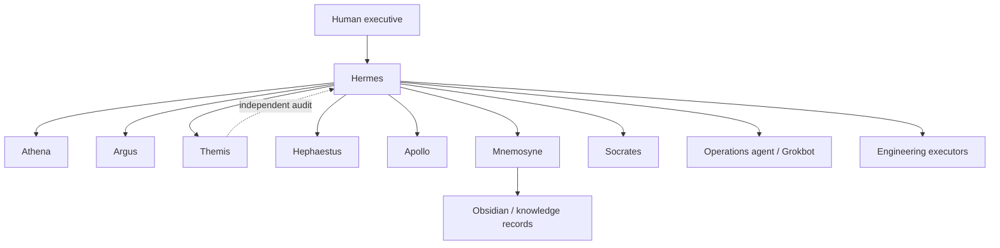

# Pantheon

**Eight specialist agents. One accountable intelligence system.**

Pantheon is an independent, open-source starter kit for [Hermes Agent](https://github.com/NousResearch/hermes-agent). It separates executive administration, strategy, intelligence, assurance, architecture, creativity, knowledge and learning from operational execution. Designed for persistent profiles, mobile gateways and an Obsidian knowledge base.

> v0.2.0 — integrated source candidate / technical preview; host acceptance is pending. Not affiliated with Nous Research. No live deployments, credentials, external connectors or personal data are included. The local governance ledger is a reference implementation, not a production authorization service.

## The roster

| Agent | Responsibility | Default model class |
|---|---|---|
| Hermes | Chief of Staff, administration, delegation | Professional |
| Athena | Strategy and decision analysis | Reasoning |
| Argus | Public intelligence and opportunities | Utility |
| Themis | Independent assurance and falsification | Independent reasoning |
| Hephaestus | Systems, robotics and architecture | Reasoning |
| Apollo | Creative direction and brand concepts | Multimodal |
| Mnemosyne | Knowledge and provenance | Professional |
| Socrates | Critical reasoning and education | Professional |



## Quick start

Prerequisites: Python 3.10+, Git, a current Hermes Agent install with `hermes profile install` support, and your own model credentials. Install Hermes using its upstream instructions. No dependency installation or network calls are made by Pantheon's validation tools.

```bash
python scripts/validate.py
python -m unittest discover -s tests -v
python scripts/install_profiles.py                 # prints plan only
python scripts/install_profiles.py --apply --agent hermes
# or install a specialist directly:
hermes profile install ./profiles/athena --alias
hermes -p pantheon-athena setup
hermes -p pantheon-athena tools list
hermes -p pantheon-athena chat
```

The default names are `pantheon-hermes`, `pantheon-athena`, etc. This avoids colliding with your existing default Hermes identity (the name `hermes` is reserved by the distribution installer). The installer never uses `--force`, does not skip confirmations, and never starts a gateway. Inspect every profile's effective capabilities before connecting a messaging platform. Installation uses local profile distributions, not an unsupported monorepo-root install. Configure existing installations manually rather than overwriting memory or credentials.

### Routines: review before activation

Copy `examples/operations-inventory.example.json` to a private file and replace its placeholder with **all** existing operational routines. Normalize purpose keys to match equivalent activities, even when names differ. Then:

```bash
python scripts/plan_routines.py --inventory /path/to/private-inventory.json
python scripts/plan_routines.py --inventory /path/to/private-inventory.json --routine H-01
```

The planner only prints commands, defaults to local delivery, and uses `--paused`. Review the command against `hermes cron create --help`; run it manually, inspect existing jobs, configure sources, and resume explicitly. No scheduled jobs ship in profiles. Equivalent purpose detection depends on an honest and complete inventory and normalized purpose keys, not semantic AI matching.

### Local governance ledger

The standard-library reference ledger records proposed handoffs, enforces idempotency, binds human approval to the immutable proposal digest, allows one atomic claim, and distinguishes claimed completion from independent verification. It **does not** dispatch or execute tasks, authenticate chat users, or connect to external systems.

```bash
python -m pantheon.ledger --db .local/ledger.sqlite propose examples/handoff.json
python -m pantheon.ledger --db .local/ledger.sqlite show PTH-HO-0001
# Review payload + digest; a trusted local operator can approve:
python -m pantheon.ledger --db .local/ledger.sqlite approve PTH-HO-0001 --digest <digest> --actor operator --ttl 3600
```

See [governance](docs/governance.md) for the full lifecycle and threat model. Never grant agent processes write access to this database in a production deployment.

## Self-improvement candidate

The shared `self-improvement` skill is registered for all eight profiles alongside their existing skills. Each specialist retains its baseline role. Hermes coordinates bounded reflection and decision preparation: at most one draft candidate and one iteration per run. Independent evidence and governance review precede an authenticated human administrator's approval of the exact candidate digest and scope for a separate production deployment.

A **role** assigns responsibility; a **routine** defines proposed cadence and purpose; a **skill** supplies procedural guidance; a **permission** is a capability enforced by the runtime. Adding the skill or a draft routine does not add permission. Existing skill grants are enumerated in [the agent registry](registry/agents.json); effective capabilities remain controlled by each unchanged profile `config.yaml` and host policy.

| Agent | Role | Existing routine IDs | Improvement responsibility | Added skill | Permissions |
|---|---|---|---|---|---|
| Hermes | Chief of Staff | H-01–H-07 | Coordinate, deduplicate, draft decision packet | `self-improvement` | Baseline only |
| Athena | Strategic Advisor | ATH-01–ATH-02 | Prioritize and compare hypotheses | `self-improvement` | Baseline only |
| Argus | Intelligence Director | ARG-01–ARG-03 | Observe and evaluate independently | `self-improvement` | Baseline only |
| Themis | Auditor General | THE-01–THE-02 | Review governance, permissions and risk | `self-improvement` | Baseline only |
| Hephaestus | Systems Architect | HEP-01 | Draft sandbox candidate and tests | `self-improvement` | Baseline only |
| Apollo | Creative Director | APO-01 | Draft reports from verified findings | `self-improvement` | Baseline only |
| Mnemosyne | Knowledge Archivist | MNE-01–MNE-02 | Draft attributed Obsidian lessons | `self-improvement` | Baseline only |
| Socrates | Intellectual Advisor | SOC-01–SOC-02 | Challenge root causes and assumptions | `self-improvement` | Baseline only |

The additional Hermes routine definitions are `pantheon-self-improvement-daily` (20:30 daily) and `pantheon-self-improvement-weekly` (Sunday 17:00), both in `America/New_York`, disabled and local-only. Before any activation, check the complete host inventory and Grokbot ownership; use one scheduler, idempotent run IDs and no catch-up loops. These are source definitions, not installed schedules or enforcement guarantees.

Baseline profiles disable terminal, file, code execution, cron, delegation and other toolsets listed in their configs. The skill supplies no connector, sandbox, repository or vault grant. A host operator must verify any existing scoped access before using it. Obsidian improvement memory consists of private draft lessons in a designated inbox; without existing authorized access, Mnemosyne returns a draft for an operator. Grokbot retains operational execution. See [integration status and acceptance requirements](docs/SELF_IMPROVEMENT_INTEGRATION.md).

## Repository map

| Path | Contents |
|---|---|
| `profiles/` | Eight native profile distributions with SOUL, baseline config and bundled skills |
| `skills/` | Canonical reusable procedural skills |
| `registry/` | Agent, model, group and disabled routine definitions |
| `governance/` | Shared constitution and operational boundary contract |
| `docs/` | Architecture, deployment, permissions, integrations, rollout and release guidance |
| `schemas/`, `examples/` | Handoff and knowledge proposal contracts and sanitized examples |
| `pantheon/` | Local reference governance ledger and private single-writer improvement review workflow |
| `scripts/`, `tests/` | Validation, installer, routine planner and unit tests |

## Guides

- [Architecture and group institutions](docs/architecture.md)
- [Mobile deployment](docs/deployment.md)
- [Security and permissions](docs/security.md)
- [Obsidian and Grokbot integration](docs/integrations.md)
- [Governance and approval ledger](docs/governance.md)
- [Rollout and acceptance](docs/rollout.md)
- [Self-improvement integration and acceptance](docs/SELF_IMPROVEMENT_INTEGRATION.md)
- [Publishing a release](docs/releasing.md)

## Upstream references

[Profiles](https://hermes-agent.nousresearch.com/docs/user-guide/profiles) · [Profile distributions](https://hermes-agent.nousresearch.com/docs/user-guide/profile-distributions) · [Bot Mode](https://hermes-agent.nousresearch.com/docs/user-guide/bot-mode) · [Configuration](https://hermes-agent.nousresearch.com/docs/user-guide/configuration) · [Toolsets](https://hermes-agent.nousresearch.com/docs/reference/toolsets-reference) · [Cron](https://hermes-agent.nousresearch.com/docs/user-guide/features/cron) · [Skills](https://hermes-agent.nousresearch.com/docs/user-guide/features/skills/)

## Contributing

See [CONTRIBUTING.md](CONTRIBUTING.md), [SECURITY.md](SECURITY.md), and [LICENSE](LICENSE). Keep secrets, live vaults, session history and private identifiers out of the repository.
